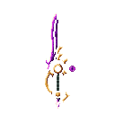
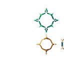
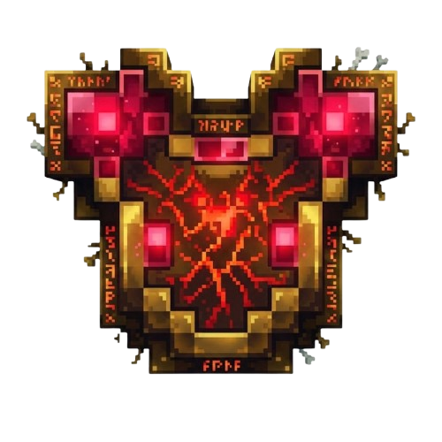
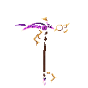
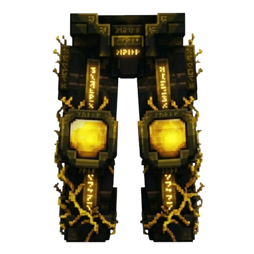
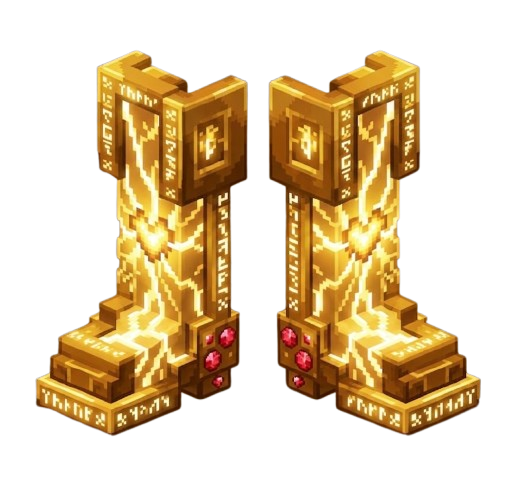

# LegendaryItemsMod

A Paper 26.3 plugin adding one-of-a-kind legendary weapons, Astral armor,
custom tracking, and Lifesteal hearts. Install the plugin JAR on the server.
The optional resource pack is needed for the custom item textures and models.

## Legendary collection

The tracker sidebar lists each crafted legendary item and its approximate
location. Carried items show the holder; dropped items are marked `ground`.
The proximity boss bar only appears when a tracked item is within range.

The operator setting `/legendary settings` controls the carry rule:

- **One armor + one tool:** one legendary armor item and one legendary
  non-armor item may be carried at once. They can be anywhere in the player's
  inventory; they do not have to be equipped or held. An additional legendary
  item triggers the overload penalty.
- **One overall:** only one legendary item may be carried without triggering
  the overload penalty.

Legendary items cannot be stored in containers or item frames; attempted
storage ejects the item. The same menu controls logout behavior, tracker
coordinate rounding, and the offline beam option. With `beacon` logout
behavior, the player keeps the items, a stationary beam remains at the logout
location, and item location tracking pauses until that player rejoins.

All legendary gear has durability and cannot receive extra enchantments. The
Astral Excavator has Efficiency V and nine times Netherite pickaxe durability;
Mjolnir has Wind Burst II. Other legendary items have 10% more durability than
their base material (items without native durability use the Netherite sword
baseline). Hearts repair legendary gear in an anvil by 33% of maximum
durability.

## Commands

All commands below are operator-only. Settings menus require an operator and
an in-game player. `/legendary destroyall` can also be run from console.

| Command | Description |
|---|---|
| `/lifesteal` or `/lifesteal settings` | Open Lifesteal settings. |
| `/lifesteal give` | Give yourself a Heart of Life. The alias `/lifesteal giveheart` is also accepted. |
| `/lifesteal set <player> <half-hearts\|reset>` | Set an online or previously seen player's maximum health in half-heart units, or reset it to the configured starting value. `/lifesteal sethearts` is also accepted. |
| `/legendary settings` | Open settings for carry rule, logout behavior, and tracker coordinate rounding. |
| `/legendary give <item_id>` | Claim and give yourself an unclaimed legendary item. |
| `/legendary destroyall` | Remove all legendary items and release their one-of-one claims. |

Item IDs accepted by `/legendary give`:
`astral_sovereign`, `mjolnir`, `storm_shuriken`, `astral_helmet`,
`astral_chestplate`, `astral_excavator`, `astral_leggings`, and `astral_boots`.

## Crafting recipes

Each recipe is shown in its exact 3×3 crafting-table arrangement. `-` denotes
an empty slot. Ingredient letters are defined under each pattern.

### Astral Sovereign



```text
D | H | D
N | S | N
D | E | D
```

`D` Diamond Block ×4 · `H` Heavy Core ×1 · `N` Nether Star ×2 ·
`S` Netherite Sword ×1 · `E` End Rod ×1

### Mjolnir


```text
H | N | H
A | M | A
H | N | H
```

`H` Heavy Core ×4 · `N` Nether Star ×2 · `A` Enchanted Golden Apple ×2 ·
`M` Mace ×1

### Storm Shuriken



```text
P | B | P
E | S | E
P | - | P
```

`P` Prismarine Crystals ×4 · `B` Breeze Rod ×1 · `E` Echo Shard ×2 ·
`S` Snowball ×1 · `-` empty

### Astral Crown (helmet)


```text
E | S | E
N | - | H
- | E | -
```

`E` Echo Shard ×3 · `S` Nether Star ×1 · `N` Netherite Helmet ×1 ·
`H` Heavy Core ×1 · `-` empty

### Astral Chestplate



```text
E | H | E
N | S | N
E | - | E
```

`E` Echo Shard ×4 · `H` Heavy Core ×1 · `N` Nether Star ×2 ·
`S` Netherite Chestplate ×1 · `-` empty

### Astral Excavator



```text
G | N | G
E | P | E
G | - | G
```

`G` Gold Block ×4 · `N` Nether Star ×1 · `E` Echo Shard ×2 ·
`P` Netherite Pickaxe ×1 · `-` empty

### Astral Greaves (leggings)



```text
E | N | E
E | L | E
N | - | N
```

`E` Echo Shard ×4 · `N` Nether Star ×3 · `L` Netherite Leggings ×1 ·
`-` empty

### Astral Striders (boots)



```text
E | - | E
N | B | N
E | - | E
```

`E` Echo Shard ×4 · `N` Nether Star ×2 · `B` Netherite Boots ×1 ·
`-` empty

### Heart of Life


```text
S | E | S
E | H | E
S | E | S
```

`S` Nether Star ×4 · `E` Echo Shard ×4 · `H` Heart of the Sea ×1

A Heart of Life grants one permanent half-heart (one health point) up to the
configured maximum. Only player kills cause Lifesteal heart loss/gain. Default
starting health is 20 half-heart units (10 full hearts); the default maximum is
40 units (20 full hearts).

## Item abilities

| Item | Abilities |
|---|---|
| **Astral Sovereign** | While held: Speed I, Jump Boost I, and Night Vision. On hit: Regeneration; 15% chance of an astral burst for 2 bonus damage. Sneak + right-click: Absorption for 6 seconds and Regeneration I for 5 seconds (30-second cooldown). Projects a sky beacon that reveals the holder's location. |
| **Mjolnir** | Wind Burst II. On hit: real lightning plus four visual lightning strikes (15-second cooldown). Sneak + right-click air while looking upward: launch upward with repeated spiraling lightning (90-second cooldown). |
| **Storm Shuriken** | Right-click: three-shuriken burst (1-second cooldown). Sneak + right-click the top of a block: radial burst and knockback (8-second cooldown). |
| **Astral Crown** | While worn: Night Vision and Water Breathing. |
| **Astral Chestplate** | While worn: Resistance I and +2 maximum health. |
| **Astral Excavator** | Efficiency V; mines a 3×3 plane based on the block face hit. Sneak + right-click: Haste 100 for 10 seconds. Durability is 9× a Netherite pickaxe. |
| **Astral Greaves** | While worn: Speed I and Jump Boost I. |
| **Astral Striders** | While worn: Speed I and Dolphin's Grace. While sneaking and falling: Slow Falling II, ending when sneak is released or the player lands. |
| **Full Astral armor set** | Regeneration and Fire Resistance. |

## Configuration and resource pack

Server defaults are in `src/main/resources/config.yml`. Operators can change
Lifesteal limits and zero-heart action in `/lifesteal settings`. Legendary
carry, logout, and tracker options are in `/legendary settings`.

The custom Heart of Life model is `legendary:life_heart`. Replace
`assets/legendary/textures/item/life_heart.png` in the resource pack with your
own 16×16-or-larger PNG, then reload the pack. Item textures are in
`LegendaryItemsPack/assets/legendary/textures/item/`.
